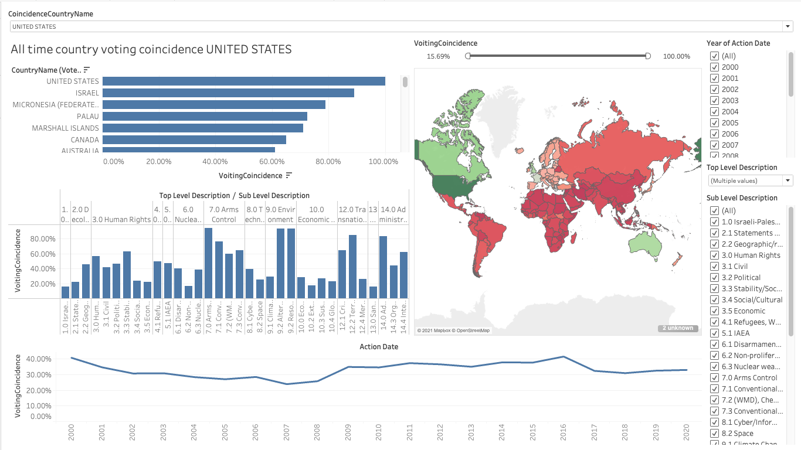
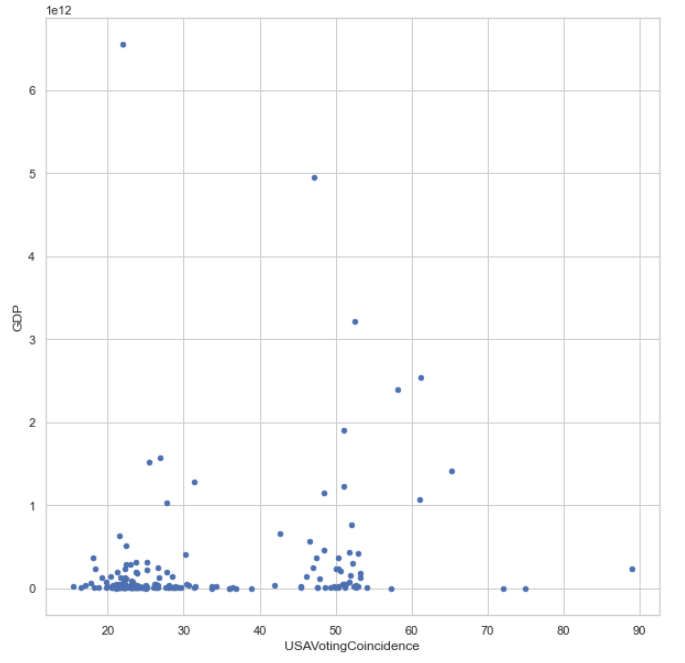
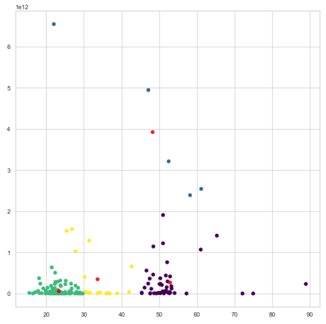
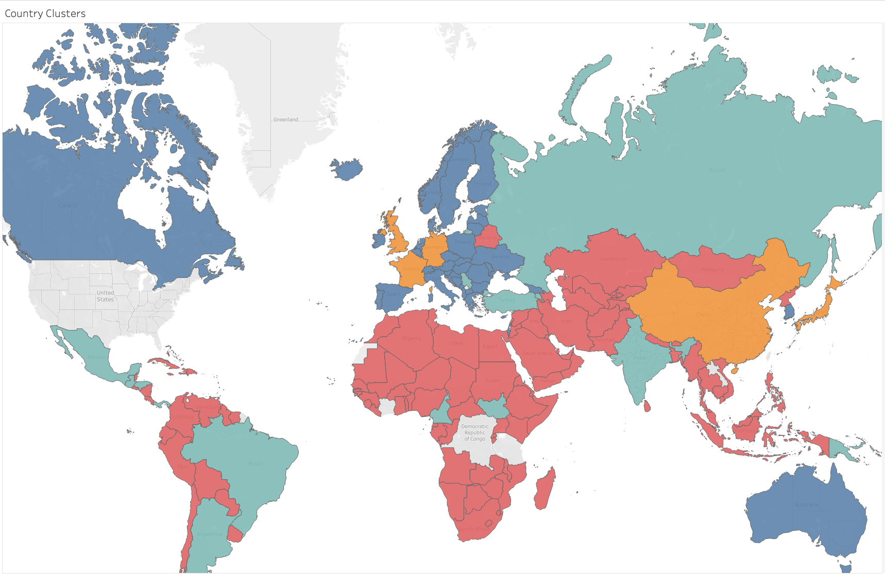

# united-nations-general-assembly-voting

The purpose of this repo is to load, map and transform United Nations General Assembly voting data.


## Python environment and setup
- Python3 is required
- openpyxl is requried - https://pypi.org/project/openpyxl/
```
pip install openpyxl
```
- tableauhyperapi is required - https://pypi.org/project/tableauhyperapi/
```
 pip install tableauhyperapi
```
- pantab is required - https://pypi.org/project/pantab/
```
pip install pantab
```
My environment is running on a M1 Macbook Pro and the Tableau Hyper API is only supported on the x86 arch.  As a result my Python environment is running in x86 emulation mode via Homebrew, started via this command.
```
/usr/local/Cellar/ipython/7.22.0/bin/ipython notebook
```


## Data Details
There are 4 input files to the process:

- Core UN Voting data
  - **path**: ./source_data/NortheasternExport4.xlsx
  - **description**: This the main input file and the first sheet is read.  The ResolutionCode column is important as it's used later to merge the category data.  The VotingInformation column contains the string payload of votes by country.  The column names are in MARC format (https://research.un.org/en/digitallibrary/export).  The column name mapping and definitions have been taken from the voting manual found here: https://www.un.org/depts/dhl/unbisref_manual/voting/voting.htm
  - **data processing**: The first step is to shred the VotingInfo column from text into rows of votes by countries.  A matrix of Country X ID of vote values Y, N and NaN (not attended) is generated.  Next, vote scores are computed for a target country and all other countries.  The scoring methedology using 1 for the same, 0 for opposite and .5 for a vote and abstain (on either side).  An absent country will receive a NaN.  All countries are run as the target country allowing for anlaysis by any coincidence country later.  By target countery, a new matrix with scores in place of the text values is generated.

- Category Lookup Table
  - **path**: ./source_data/GA Votes Working Document.xlsx - Top level Sub level description.csv
  - **description**: This file is the lookup table of category level values.
  - **data processing**: The data is transformed into a heirachy format, repeating level data where necessary.  Level numbers are prepended to the name values and categories with NULL sub-level values are filled with the top-level.  Enforcing the integrity of a single level heirarchy.

- UN Resolution Code to Top / Sub Leve Code Mapping
  - **path**: ./source_data/GA Votes Working Document.xlsx - Top Level Sub level.csv
  - **description**: This is the mapping of UN Resolution code to category values.
  - **data processing**: No processing is applied and only the ResolutionCode, TopLevel and SubLevel column are kept.  This table is used to update the original Voting Info data with the category levels to allow for joining between VoteInfo and Category data.

- GDP Data
  - **path**: ./source_Data/Download-GDPcurrent-USD-countries.xlsx
  - **description**: GDP data by country, year taken from the UN stats site here: https://unstats.un.org/unsd/snaama/Downloads.  GDP is broken down at it's currenct price in US Dollars for all countries for all years, sorted alphabetically.
  - **data processing**: No processing other than filter for just GDP is applied here.

## Data processing methodology
- Core UN Voting data

- UN 

## Data pipeline to Tableau
The Tableau Hyper file format is used as it provides superior speed and compression over the original output csv files.  The current code writes out a single UNVotingData.hyper file that is consumed as the data source within the UNVoting.twb file.  The singe Hyper file contains 3 tablues - VoteInfo, Categories & VoteScore.  VoteInfo and Categories have a multilevel relationiship defined on TopLevel / SubLevel.  VoteInfo and VoteScore have a single level relatinship on ID.  The VotingCoincidence is calculated and defained as *sum([Score]) / count([Score])*.  This allows for the measure to recomputed on the fly while the user adjustes Tableau filters and descriptive classification levels.

## Cluster analysis

## Visual Output
Final dashboard outpit



GDP x US Voting Coincidence



Country Clusters



Country Cluster - Geographical


